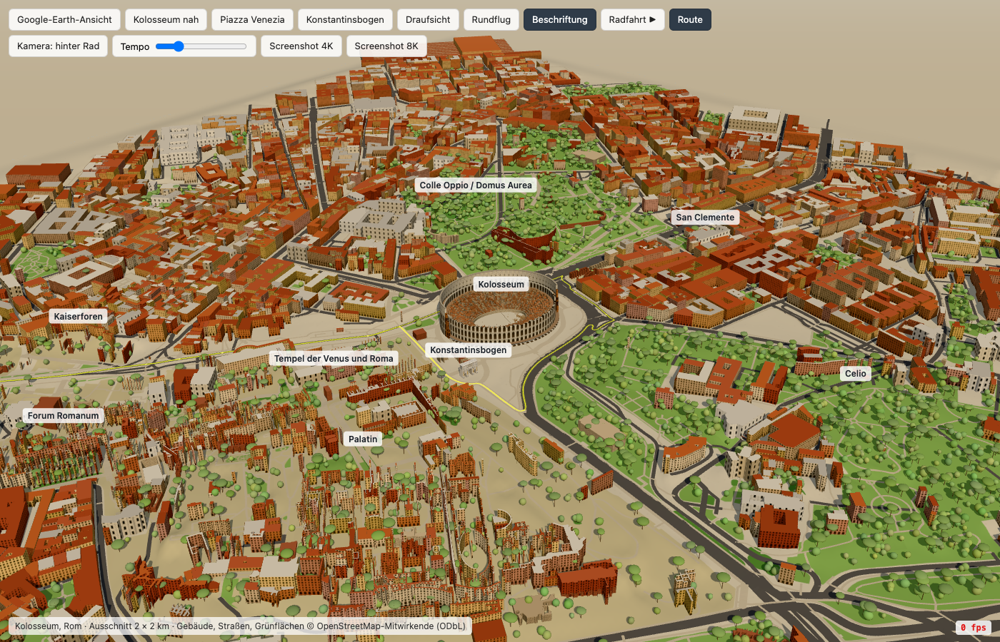
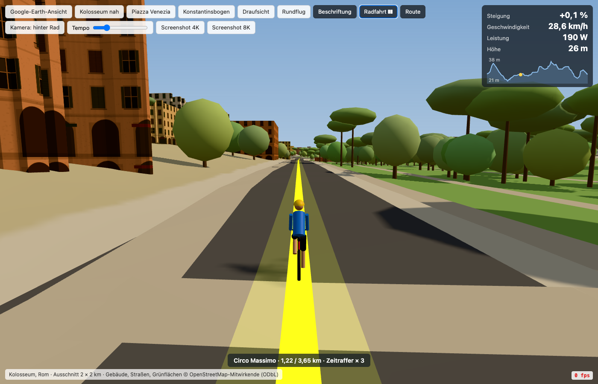

# Kolosseum 3D

Ein Three.js-Modell der Innenstadt von Rom auf einer einzigen Seite: ein Ausschnitt von 2 × 2 km rund um das Kolosseum, erstellt aus OpenStreetMap-Daten und SRTM-Geländedaten. Es enthält ein prozedural erzeugtes Kolosseum und Vittoriano sowie eine animierte Radfahrt von der Piazza Venezia über die Via dei Fori Imperiali, um das Kolosseum herum und zurück. Eine Anzeige zeigt dabei Steigung, Geschwindigkeit, Leistung und Höhe.





## Starten

```
open roma3d.html
```

Ein Server oder Build-Schritt ist nicht nötig. Three.js r0.165 wird von jsDelivr geladen, die Szenendaten stehen in `scene.js`.

## Ansichten und Bedienung

Die Schaltflächen oben bieten:

| Schaltfläche | Funktion |
|---|---|
| Google-Earth-Ansicht, Kolosseum nah, Piazza Venezia, Konstantinsbogen, Draufsicht | Vordefinierte Kameraansichten |
| Rundflug | Kreisflug um die Szene |
| Beschriftung | Beschriftungen ein- und ausblenden |
| Radfahrt ▶ | Radfahrt starten |
| Route | Routenlinie ein- und ausblenden |
| Kamera | Kameramodus der Radfahrt wechseln |
| Tempo | Abspielgeschwindigkeit der Radfahrt |
| Screenshot 4K / 8K | Bild in hoher Auflösung speichern |

Ein URL-Hash öffnet eine Ansicht direkt: `#ge`, `#close`, `#venezia`, `#arco`, `#top`. `?t=<Sekunden>#ride` startet die Radfahrt und spult sie um die angegebene Zeit vor.

## Daten neu erzeugen

Eingaben sind ein Overpass-Export (`data/osm.json`) und Terrarium-Höhenkacheln (`data/tiles/`). Die Schritte müssen in dieser Reihenfolge laufen, weil jeder `data/scene.json` und `scene.js` neu schreibt:

```
cd data && python3 process.py && python3 route.py osm.json scene.json ../scene.js && python3 terrain.py
```

`terrain.py` benötigt numpy und Pillow.

| Skript | Ergebnis |
|---|---|
| `process.py` | Gebäude, Straßen und Flächennutzung, projiziert in lokale Meter um das Kolosseum |
| `route.py` | Radroute per Dijkstra über das OSM-Straßennetz, bevorzugt Fahrbahnen |
| `terrain.py` | Höhenmodell ohne Gebäude, mit eingearbeiteten Straßenhöhen |

## Datenquellen

- Kartendaten © [OpenStreetMap](https://www.openstreetmap.org/copyright)-Mitwirkende, ODbL
- Höhendaten: SRTM über [Terrarium-Kacheln](https://registry.opendata.aws/terrain-tiles/)
